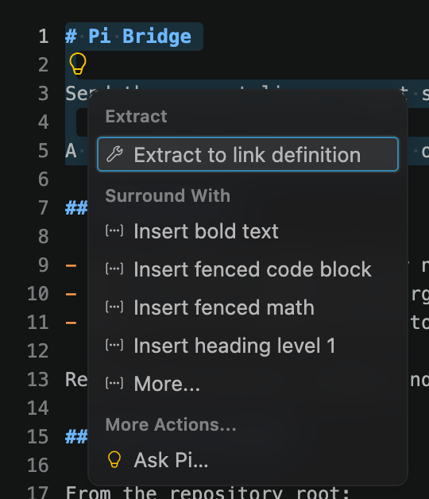
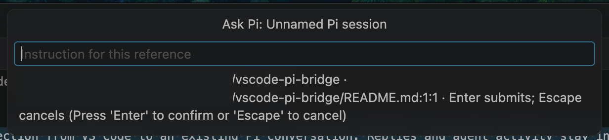

# Pi Bridge

Send the current line or exact selection from VS Code to an existing Pi conversation. Replies and agent activity stay in Pi's terminal.

An experimental personal tool, used by its author on local macOS, with best-effort maintenance. Licensed under [MIT](LICENSE). Install locally from a `.vsix`; no VS Code Marketplace listing or npm publication is needed.

## Requirements

- Local macOS, VS Code 1.96 or newer.
- Pi 1.5.2 (the companion's target API; other versions are unverified).
- Node.js 22 or newer and npm to build.

Remote SSH/container windows and web VS Code are not supported.

## Build and install

From the repository root:

```sh
npm ci --ignore-scripts
npm run package
code --install-extension ./dist/vscode-pi-bridge-0.1.0.vsix --force
pi -e "$PWD/dist/pi.cjs"
```

Packaging runs the TypeScript check and builds both bundles. It does not run tests, install the extension, connect a session, or start model work. `ws` is bundled; Pi and VS Code are provided by their hosts.

The last command starts Pi with the companion loaded. Loading alone does not connect it to VS Code. To load the companion in future sessions, add its absolute `dist/pi.cjs` path to the `extensions` array in `~/.pi/agent/settings.json`, preserving existing entries. Use either that setting or `pi -e`, not both.

After updates, build and install again, then reload VS Code and restart/reload Pi. Pair again. The VSIX filename follows the version in `package.json`.

## Use

1. Open your workspace in VS Code.
2. In the intended Pi conversation, run `/vscode connect` and choose the VS Code window.
3. In VS Code, run **Select Pi session…** from the Command Palette or status bar. Select the intended conversation.
4. In a saved file, select text or place the cursor on a line. Use **Ask Pi…** from the Command Palette, editor context menu, Code Action (`⌘.`), or **⌘⌥⇧P**.
5. Enter an instruction. Enter sends; Escape cancels. A send can start normal model work and costs.

Choose **Ask Pi…**, then enter an instruction:

| Code Action | Instruction |
| --- | --- |
|  |  |

The reference is captured before any picker opens. A cursor captures the whole line without its newline; a selection preserves the exact characters. Dirty files, untitled documents, non-file documents, and multiple selections are rejected. The bridge never saves or edits files itself.

Both the VS Code window and Pi conversation require explicit selection, even when only one is available. Nothing automatically connects, retries, or replays after a disconnect. `/vscode status` shows the connection; `/vscode disconnect` revokes it. Session changes and renaming require pairing again. Changing workspace folders requires a VS Code window reload.

## Delivery and recovery

- **Submitted**: Pi API submission was attempted; insertion is not yet confirmed. Busy Pi receives a follow-up, not an interrupt.
- **Delivered**: the exact user message was observed in the selected conversation. This does not mean the agent finished or saved its work.
- **Unknown delivery**: submission may have succeeded, but confirmation was lost or timed out. Check Pi before resending.
- **Not submitted**: rejected before submission.

**Pi: Recover request…** can copy a captured request or resend it with a new ID after a duplicate-work warning and explicit destination selection. Requests stay in window memory only and disappear on reload/shutdown.

Disconnecting does **not** cancel accepted follow-ups. Unconfirmed submissions can block Pi session navigation; inspect the native queue before deliberately reloading Pi. Reloading clears bridge bookkeeping, not necessarily queued work.

## Troubleshooting

- **No VS Code window found:** Open a supported local macOS VS Code window with Pi Bridge enabled. If needed, run **Developer: Reload Window**, then run `/vscode connect` again in Pi. Remote SSH/container windows and web VS Code are unsupported.
- **Companion commands unavailable:** If Pi does not recognize `/vscode`, load the companion with `pi -e /absolute/path/to/dist/pi.cjs` or configure its absolute path as described above. The target Pi version is 1.5.2; compatibility with other versions is unverified.
- **No Pi session listed:** Loading the companion does not pair it. Run `/vscode connect` in the intended conversation, choose the correct VS Code window, then run **Select Pi session…** in that window. `/vscode status` shows whether Pi is connected.
- **Listener could not start:** Check that `~/.vscode-pi-bridge` and its `runtime` directory are real directories owned by your OS user with owner-only permissions (`0700`). The listener also needs permission to bind to `127.0.0.1`. Do not share discovery files; they contain credentials.
- **Stale window or disconnected session:** Nothing reconnects automatically. Check `/vscode status`, run `/vscode connect`, and explicitly select the session again in VS Code. After changing workspace folders, reload the VS Code window first. Old discovery files are not proof that a window is still available; do not edit their credentials or select another destination as a workaround.
- **Unknown delivery or blocked reconnect/navigation:** Inspect the intended Pi conversation and its native follow-up queue before resending. Disconnect does not cancel queued work. Use **Pi: Recover request…** to copy the captured request; resend only after checking for duplicate work. If an unconfirmed request never resolves, deliberately reloading Pi clears bridge bookkeeping, not necessarily accepted follow-ups.
- **After an update:** Rebuild and reinstall the VSIX, restart/reload Pi with the matching companion, reload VS Code, and pair again. Updating only one side can leave mismatched components.

If reporting a problem, include macOS, VS Code, Node.js, and Pi versions, the action you took, and the exact error text. Omit discovery files, credentials, and private snippets.

## Privacy and limits

- Local WebSocket transport on `127.0.0.1`, authenticated with a random per-runtime credential. Browser Origin headers are rejected. No browser service, model credentials, terminal injection, or agent launcher.
- Discovery files live in `~/.vscode-pi-bridge/runtime/`, with owner-only directories and files. Never share these files: they contain credentials. This protects against other users, not software running as your OS user.
- Paths and snippets are sent as untrusted reference data in a normal user message. Pi must verify current files before editing. Other Pi extensions can transform or consume messages, leaving delivery unknown.
- Instructions: 8 KiB; serialized reference: 16 KiB; transport frame: 64 KiB. Oversized content is rejected, never truncated.
- Each side tracks at most 500 requests per runtime. Copy anything needed before deliberately reloading and pairing again. VS Code accepts at most 32 simultaneous sockets.
- Coordinates are 1-based UTF-16 columns with an exclusive end position.

## Development

```sh
npm run check
npm run build
npm test
```

`npm test` type-checks, builds both bundles, compiles the checks into `dist/checks/`, and runs them with Node's test runner. It does not launch VS Code or Pi, or start model work. Packaging does not run these checks.

Source is in `src/`; focused checks are in `checks/`. The build bundles only this code and `ws`, not the development toolchain. Review dependency advisories with `npm audit`; do not assume development dependencies are vulnerability-free.

`private: true` prevents accidental npm publication. `publisher: local-pi` supplies the local VS Code extension ID; it does not register or publish anything. The `vscode:prepublish` script is VS Code's build hook, also used by local packaging—not a publish command.

## Remove

Run `/vscode disconnect`, then:

```sh
code --uninstall-extension local-pi.vscode-pi-bridge
```

Remove the companion path from Pi settings if configured, and restart/reload both applications. With all bridge instances closed, you may delete `~/.vscode-pi-bridge`. Already accepted Pi follow-ups are not cancelled.
